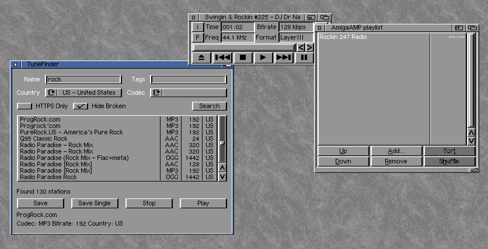

# TuneFinder

TuneFinder is an AmigaOS 3.x application that allows you to browse, save playlist and play Internet radio stations. It uses the Radio Browser API to search for stations worldwide.

# TuneFinder MUI

If you enjoy using TuneFinder, you might also want to check out [**TuneFinderMUI**](https://github.com/sandlbn/TuneFinderMUI)! It offers similar features with a modern and user-friendly MUI interface for AmigaOS 3.x. 

## Features
- Search radio stations by name, country, codec, or tags
- Filter stations by HTTPS (all / HTTPS only / no HTTPS) and broken links
- Sort by name, votes, popularity, bitrate or random; "More" loads the next page
- Save stations as PLS playlists
- Play stations in AmigaAmp; the status line shows Connecting and then Playing, and the current track is shown while playing
- HLS streams (not playable by AmigaAMP) and stations that failed their last check are marked
- Favorites
- ARexx port for scripting
- Configurable API settings
- Compatible with AmigaOS 3.x (68020+ CPU recommended)
- Support for Amiga translation library

## Requirements
- AmigaOS 3.x
- 68000 CPU or better
- At least 4MB RAM
- Internet connection
- Working TCP/IP stack with bsdsocket.library (Roadshow, AmiTCP, Miami, ...)
- AmigaAMP with [mpega.library](https://aminet.net/package/util/libs/mpega_library) for playback
- AmiSSL in AmigaAMP for HTTPS streams (optional)


## Building

### Prerequisites
If you're cross-compiling on Linux, you need:
- amiga-gcc compiler (bebbo's toolchain) or Docker or sacredbanana/amiga-compiler docker image
- GNU Make
- Amiga NDK 3.2 or sacredbanana/amiga-compiler Docker image

### Build Instructions

1. Standard build (release version):
```bash
make
```
or 
```bash
docker run --rm  -v ${PWD}:/work -it sacredbanana/amiga-compiler:m68k-amigaos make release
```
2. Debug build with additional logging:
```bash
make debug
```
or 
```bash
docker run --rm  -v ${PWD}:/work -it sacredbanana/amiga-compiler:m68k-amigaos make debug
```

3. Toolchain outside `/opt/amiga`:
```bash
make AMIGA_PREFIX=/path/to/amiga-gcc
```

4. Host unit tests for the platform independent code (URL building, JSON parsing, favorites format; needs a native compiler and json-c):
```bash
make test
```

5. Clean build files:
```bash
make clean
```
or 
```bash
docker run --rm  -v ${PWD}:/work -it sacredbanana/amiga-compiler:m68k-amigaos make clean
```

The compiled binary will be placed in the `out` directory.

## Translation

To translate TuneFinder to a new language, create a new .ct file with the same structure as shown in [assets/translation](assets/translation/tunefinder.cd) , replacing each English text line with your translated version while keeping the MSG_ identifiers and semicolons untouched. Make sure to update the language code in the header of your .ct file (e.g., ## language deutsch for German). 
After creating your translation file, use the command 

```bash
flexcat tunefinder.cd yourlanguage.ct CATALOG LOCALE:Catalogs/yourlanguage/tunefinder.catalog
```

To use it in the docker 

```bash
docker run --rm  -v ${PWD}:/work -it sacredbanana/amiga-compiler:m68k-amigaos flexcat assets/translation/tunefinder.cd assets/translation/tunefinder_polish.ct CATALOG tunefinder.catalog
```

to generate the catalog file, then place the generated catalog in your LOCALE:Catalogs/yourlanguage/ directory.

## Installation

1. Copy the TuneFinder executable to your Amiga

## Usage

1. Launch TuneFinder
2. Enter search criteria (name, country, codec, or tags)
3. Click "Search" to find stations
4. Select a station to view details
5. Use "Save" to create a PLS playlist file or "Play" to play selected station in the AmigaAmp

## ARexx

The ARexx port is `TUNEFINDER`:

| Command | Description |
|---|---|
| `SEARCH [NAME]` | Search; the other filters are taken from the window. RESULT is the status line |
| `MORE` | Load the next page of results |
| `SORT NAME\|VOTES\|POPULAR\|BITRATE\|RANDOM` | Set the sort order |
| `COUNT` | Number of stations in the list |
| `SELECT INDEX` | Make a station active (0 is the first) |
| `ACTIVE` | `name\|url\|codec\|country\|bitrate` of the active station |
| `PLAY`, `STOP` | Control playback in AmigaAMP |
| `ADDFAV`, `REMOVEFAV` | Add or remove the active station |
| `FAVORITES` | Show the favorites list |
| `STATUS`, `TRACK` | Status line, current track |
| `QUIT` | Quit TuneFinder |

Commands that use the window fail with RC 10 while TuneFinder is iconified.

```rexx
/* Play the first jazz station */
ADDRESS TUNEFINDER
OPTIONS RESULTS
SEARCH jazz
SELECT 0
PLAY
```

## Screenshot



## Credits
Created by sandlbn
